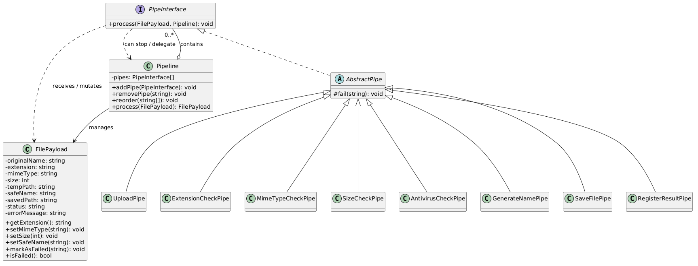

# Лабораторная работа: Сервис обработки файлов (Pipeline Architecture)

## Вариант 17

## О работе

В рамках лабораторной работы выполнено **проектирование** сервиса обработки файлов
с использованием языка моделирования UML. Программная реализация (PHP-код)
**не выполнялась** — результатом работы является UML-модель классов,
отражающая выбранный архитектурный подход и распределение ответственности
между компонентами системы.

## Предметная область

Проектируется сервис, обрабатывающий файлы, загружаемые пользователями.
Файл не сохраняется сразу, а последовательно проходит через независимые
этапы проверки и обработки. При ошибке на любом этапе цепочка
останавливается, и файл не попадает в постоянное хранилище.

## Выбранный архитектурный подход

**Pipeline Architecture**. Обработка представлена как последовательность
этапов (`Pipe`). Каждый этап получает общий объект состояния (`FilePayload`),
выполняет одну операцию и передаёт его дальше по цепочке.

## Основные сущности UML-модели

| Сущность | Ответственность | Ключевые свойства / методы (UML) |
|---|---|---|
| `FilePayload` | Хранит состояние файла в процессе обработки | `originalName`, `extension`, `mimeType`, `size`, `safeName`, `status`; `markAsFailed()`, `isFailed()` |
| `PipeInterface` | Контракт для любого этапа Pipeline | `process(payload: FilePayload, pipeline: Pipeline)` |
| `Pipeline` | Управляет набором этапов, их порядком и запуском | `pipes: PipeInterface[]`; `addPipe()`, `removePipe()`, `reorder()`, `process()` |
| `AbstractPipe` | Базовая логика для этапов (остановка при ошибке) | `fail(message: string)` |
| `UploadPipe` | Получение файла | `process()` |
| `ExtensionCheckPipe` | Проверка расширения | `allowedExtensions: string[]` |
| `MimeTypeCheckPipe` | Проверка MIME-типа | `allowedMimeTypes: string[]` |
| `SizeCheckPipe` | Проверка размера | `maxSize: int` |
| `AntivirusCheckPipe` | Условная антивирусная проверка | `process()` |
| `GenerateNamePipe` | Генерация безопасного уникального имени | `process()` |
| `SaveFilePipe` | Сохранение файла | `storagePath: string` |
| `RegisterResultPipe` | Регистрация результата | `process()` |

## UML-диаграмма классов

Модель построена в нотации UML (диаграмма классов).
Исходный код диаграммы в формате PlantUML находится в файле
[`docs/class-diagram.puml`](docs/class-diagram.puml).
Экспорт в изображение выполнен через онлайн-рендерер PlantUML.

## Как модель покрывает требования

- **Добавление нового этапа** — через реализацию `PipeInterface` и вызов
  `Pipeline.addPipe(pipe)`.
- **Удаление этапа** — через `Pipeline.removePipe(pipeClass)`.
- **Изменение порядка** — через `Pipeline.reorder(classNames)`.
- **Передача результата между этапами** — все этапы получают и модифицируют
  один и тот же объект `FilePayload`.
- **Остановка Pipeline при ошибке** — этап вызывает `AbstractPipe.fail()` или
  `FilePayload.markAsFailed()`; в `Pipeline.process()` проверяется
  `FilePayload.isFailed()` и выполнение прерывается.

## Структура репозитория
??? README.md
??? docs/
? ??? class-diagram.png # экспорт UML-диаграммы
? ??? class-diagram.puml # исходник модели (PlantUML)
??? .gitignore

Папка `src/` отсутствует намеренно: в рамках этой работы PHP-код не реализуется,
модель служит основой для будущей реализации.